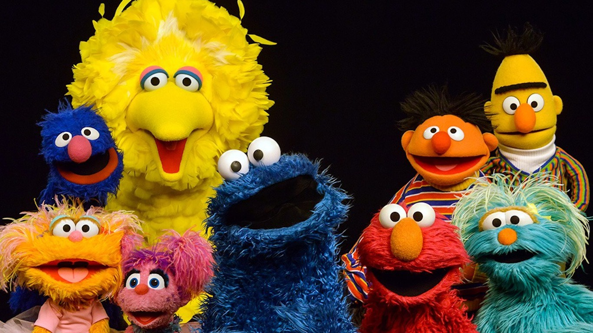

# sesamestreet



A collection of character-level language models built from scratch, mostly in
PyTorch and mostly in Jupyter notebooks. Every subproject learns to generate
names character by character from the same dataset: `data/names.txt`, a list of
roughly 55,000 names. Each subproject keeps its own copy of that file.

## Subprojects

### cookiemonster

`cookiemonster/cookiemonster.ipynb`

The baseline. It builds a bigram (previous character to next character) count
matrix over a 27-symbol vocabulary (a-z plus `.` for the start/end of a word),
turns the counts into probabilities with add-one smoothing, and samples names
from the result. It then reframes the same problem as a neural network: a single
`27 x 27` weight matrix trained with a softmax cross-entropy loss and plain
gradient descent, and samples from that network instead.

### elmo

`elmo/` contains three notebook versions of the MLP approach:

- `elmo.ipynb` - a multilayer perceptron with a learned character embedding
  table, a `tanh` hidden layer, and a manual softmax/cross-entropy forward pass.
- `elmo2.0.ipynb` - the same idea cleaned up into an explicit training loop with
  Kaiming-style initialization, manual batch normalization, configurable
  embedding and hidden sizes, and train/validation loss reporting.
- `elmo3.0.ipynb` - a PyTorchified rewrite that wraps the model in small
  `Linear`, `BatchNorm1d` and `Tanh` classes, stacks five hidden layers of 100
  units, trains for 200,000 steps with learning-rate decay, and generates words
  by sampling from the softmax output.

All three use a context window of 3 characters and an 80/10/10 train/dev/test
split.

### ernie

`ernie/ernie.ipynb`

The notebook for the custom-backpropagation MLP variant is currently empty (a
placeholder with no cells). The directory does include its own copy of
`data/names.txt`, but there is no code to run yet.

### grover

`grover/grover.ipynb`

A convolutional, WaveNet-inspired model (DeepMind, 2016) for next-character
prediction. It uses a longer context window of 8 characters, splits the
sequence with `FlattenConsecutive` layers that progressively merge neighbouring
characters, and alternates dilated-style linear layers, batch normalization and
`tanh` activations. The notebook defines `Embedding`, `FlattenConsecutive`,
`Sequential`, `Linear`, `BatchNorm1d` and `Tanh` classes, trains for 200,000
steps, and samples new names from the model.

## Requirements

- Python 3 with Jupyter (notebook or JupyterLab)
- PyTorch
- NumPy (installed with PyTorch)
- Matplotlib
- tqdm (`elmo2.0.ipynb`, `elmo3.0.ipynb`, `grover.ipynb`)

There is no requirements file in the repository; install the packages above in
a virtual environment, for example:

```bash
python -m venv .venv
source .venv/bin/activate
pip install jupyter torch matplotlib tqdm
```

## Running a notebook

Each notebook reads its data with a relative path such as `data/names.txt`, so
start Jupyter from the subproject directory you want to run:

```bash
cd grover
jupyter notebook grover.ipynb
```

Then run the cells from top to bottom. The notebooks are self-contained: they
load the names, build the vocabulary and datasets, define the model, train it,
report train/validation loss, and print generated names. Training the larger
models (`elmo3.0`, `grover`) runs for 200,000 steps and can take a while on CPU.

## sesamestreet.jpg

`sesamestreet.jpg` is only the banner image displayed at the top of this README;
none of the models use it.
